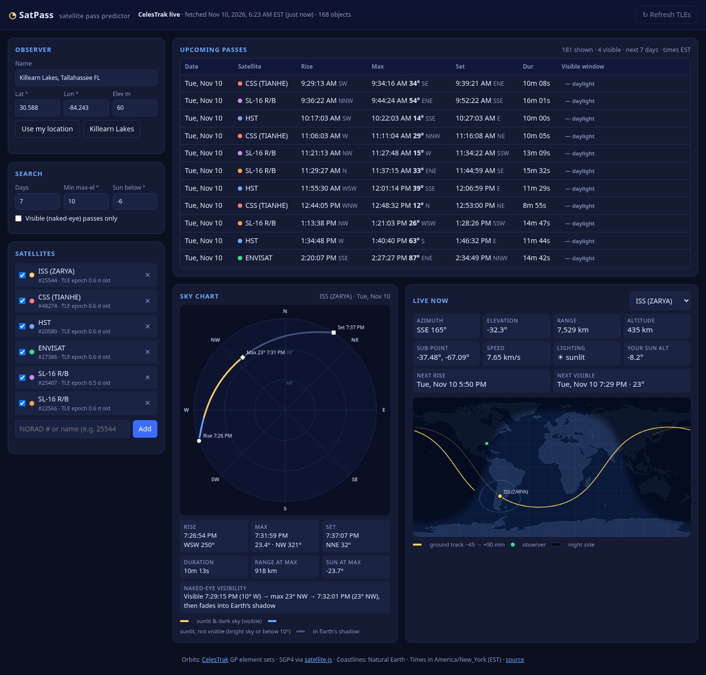

# SatPass: satellite pass predictor

A static, browser-only satellite pass predictor. It downloads live orbital elements from CelesTrak, runs SGP4 in your browser, and shows when the ISS, Tiangong, Hubble and other bright satellites cross your sky. It also tells you which passes you can actually see with the naked eye.

Defaults to **Killearn Lakes, north Tallahassee, FL** (30.588° N, 84.243° W, 60 m). You can type any location or click **Use my location**. All times are shown in **America/New_York** (EST/EDT).



## Features

- **7-day pass list** (1 to 10 days) for every satellite you've ticked. Each pass shows rise, culmination and set times, max elevation, compass directions and duration.
- **Naked-eye visibility.** A pass counts as visible when *you* are in darkness (sun below −6° by default, which you can change), the satellite is **sunlit** (not in Earth's shadow), and it's at least 10° up. The visible window gets its own start, peak and end times, accurate to about 1 s.
- **Polar sky chart** for the selected pass. The track is colored by state: visible, sunlit but not visible, or in shadow. Rise, max and set are marked.
- **Live now** panel with current azimuth/elevation, range, altitude, sub-satellite point, speed, sunlit/shadow, and the next rise and next visible pass.
- **Ground-track world map** covering −45 to +90 min, with the visibility footprint, your location, and the day/night terminator. It's drawn on a canvas with Natural Earth outlines, no map library.
- **Add any satellite** by NORAD catalog number or name. It searches the loaded catalog first, then queries CelesTrak. Remove satellites with ✕.
- Settings, your satellite list, and the last TLE download are saved in `localStorage`.

Default satellites: ISS (25544), Tiangong/CSS (48274), Hubble (20580), Envisat (27386), and two SL-16 rocket bodies (25407, 22566).

## Live data source

Orbital elements come from **[CelesTrak](https://celestrak.org/)**'s GP API as TLEs:

| Request | Used for |
|---|---|
| `gp.php?GROUP=stations&FORMAT=tle` | ISS, Tiangong and other crewed stations |
| `gp.php?GROUP=visual&FORMAT=tle` | the roughly 160 brightest satellites ("visual" group) |
| `gp.php?CATNR=<norad>&FORMAT=tle` | adding a satellite by catalog number |
| `gp.php?NAME=<text>&FORMAT=tle` | adding a satellite by name |

**CORS:** CelesTrak sends `Access-Control-Allow-Origin: *`, so the browser can fetch it directly from `https://…pages.dev`, from `localhost`, or even from a `file://` page. No proxy or server is needed. This was verified with real request headers and in headless Chrome.

**Being polite:** CelesTrak updates GP data about every 2 hours and blocks clients that poll too often. SatPass therefore:
- reuses the cached download (in `localStorage`) for 2 hours before fetching again automatically
- disables the manual **↻ Refresh TLEs** button for 10 minutes after each download

**Offline fallback:** if the live request fails (offline, blocked, or CelesTrak is down), SatPass uses the last cached download. If there isn't one, it uses a **bundled snapshot** (`data/fallback-tle.js`). The header always shows which source is in use and how old it is. TLE accuracy degrades over days, so each satellite in the list also shows its TLE epoch age, in orange when it's older than 5 days. To refresh the bundled snapshot:

```bash
node tools/update-fallback.mjs
```

## How passes and visibility are computed

All of this runs in `js/core.js`, using [satellite.js](https://github.com/shashwatak/satellite-js) (SGP4/SDP4).

1. **Propagation:** each TLE is converted to a `satrec` and propagated with SGP4. Positions are rotated to Earth-fixed coordinates with GMST and converted to topocentric azimuth/elevation/range for the observer (WGS-84 geodetic lat/lon/height).
2. **Pass search:** elevation is sampled every 30 s. Each crossing of the 0° horizon is refined by bisection to about 0.5 s (rise/set), and culmination is found with a golden-section search (about 0.5 s). Passes whose max elevation is below the **Min max-el** setting are hidden. Objects that stay up for more than 6 h (GEO-like) are skipped.
3. **Sun and shadow:** the sun position comes from `satellite.sunPos`. The observer's sun altitude decides whether the sky is dark enough. Earth's shadow comes from `satellite.shadowFraction`, which models the solar disc covered by Earth; the satellite counts as sunlit when less than half the disc is hidden.
4. **Visible window:** each pass is sampled every 10 s. A point is *visible* when the sun is below the threshold, the satellite is sunlit, and it's at least 10° above the horizon. The window edges are refined by bisection to about 1 s.

Rise/set are reported at the true 0° horizon. The *visible window* is what to plan around, and it matches how Heavens-Above lists visible passes (start/end at 10° or at shadow entry).

## Accuracy check

ISS (25544), TLE epoch 2026-11-09 20:27 UTC, observer 30.588° N 84.243° W 60 m, 7-day window starting 2026-11-10 11:00 UTC:

**vs. an independent [Skyfield](https://rhodesmill.org/skyfield/) computation** (same TLE, DE421 ephemeris for the sun and shadow), over all 46 passes:

| Quantity | Max abs difference |
|---|---|
| Rise time | 0.38 s |
| Culmination time | 0.19 s |
| Set time | 0.34 s |
| Max elevation | 0.01° |
| Sun altitude at culmination | < 0.01° |
| Sunlit/shadow state at culmination | 0 mismatches |

**vs. [Heavens-Above](https://www.heavens-above.com/)** visible ISS passes for the same location (EST):

| Pass | Heavens-Above (start / max / end) | SatPass (start / max / end) |
|---|---|---|
| Tue Nov 10 | 7:29:15 W 10° / 7:31:59 23° / 7:32:03 | 7:29:15 W 10° / 7:31:59 23.4° / 7:32:01 |
| Wed Nov 11 | 6:41:00 WSW 10° / 6:44:11 42° / 6:46:37 | 6:41:01 WSW 10° / 6:44:11 41.9° / 6:46:32 |
| Fri Nov 13 | 6:43:42 WNW 10° / 6:45:39 15° / 6:47:38 | 6:43:42 WNW 10° / 6:45:39 14.6° / 6:47:36 |

Start and peak times agree to within about 1 s. Shadow-entry times differ by 2 to 5 s because the two tools use different Earth-shadow models. Heavens-Above also showed **no** visible Envisat or SL-16 (25407) passes in that window, and the same is true in SatPass. Hubble's low dawn passes on Nov 17/18/19 (6:27:40, 5:54:33 and 5:21:42 AM) match SatPass's 10-day results (6:27:40, 5:54:34 and 5:21:44 AM).

## Run locally

There's no build step and nothing to install. Either:

- double-click `index.html` (works from `file://`; tested in Chrome), or
- serve the folder: `python3 -m http.server 8000`, then open <http://localhost:8000>.

"Use my location" needs a secure context (https, localhost, or file).

## Deploy on Cloudflare Pages

1. Push this repo to GitHub.
2. In the Cloudflare dashboard, go to **Workers & Pages → Create → Pages → Connect to Git** and pick the repo.
3. Build settings: **Framework preset:** None · **Build command:** *(leave empty)* · **Build output directory:** `/`
4. Click **Save and Deploy**. The site goes live at `https://<project>.pages.dev`.

Or from a terminal: `npx wrangler pages deploy . --project-name satpass`

## Project layout

```
index.html              page
css/style.css           dark UI
js/core.js              TLE parsing, look angles, sun/shadow, pass search (no DOM)
js/app.js               UI, data loading, sky chart, live panel, map
vendor/satellite.min.js satellite.js 7.1.0 subset bundle (MIT)
data/fallback-tle.js    bundled TLE snapshot (offline fallback)
data/land-110m.js       Natural Earth 110m land outlines (public domain)
tools/update-fallback.mjs  refresh the bundled snapshot (Node 18+)
docs/screenshot.png
```

## Limitations

- The TLE + SGP4 accuracy is about 1 km at epoch and drifts with TLE age. ISS reboosts and maneuvers can shift times by tens of seconds until a new TLE is published.
- There's no magnitude/brightness estimate. "Visible" means geometrically observable, not guaranteed bright (rocket bodies and Hubble are dimmer than the ISS).
- No atmospheric refraction (about 0.5° at the horizon, which only affects rise/set by a few seconds). Terrain and buildings aren't modeled.
- Times are always shown in America/New_York, even if you move the observer elsewhere.
- Starlink trains and other very large groups aren't preloaded. Add individual objects by NORAD number.

## Credits and license

Orbital data © [CelesTrak](https://celestrak.org/) (T.S. Kelso). SGP4 by [satellite.js](https://github.com/shashwatak/satellite-js) (MIT, see `vendor/satellite.js-LICENSE.md`). Coastlines from [Natural Earth](https://www.naturalearthdata.com/) via world-atlas.

Code © 2026 Luke de Wet, released under the [MIT License](LICENSE).
