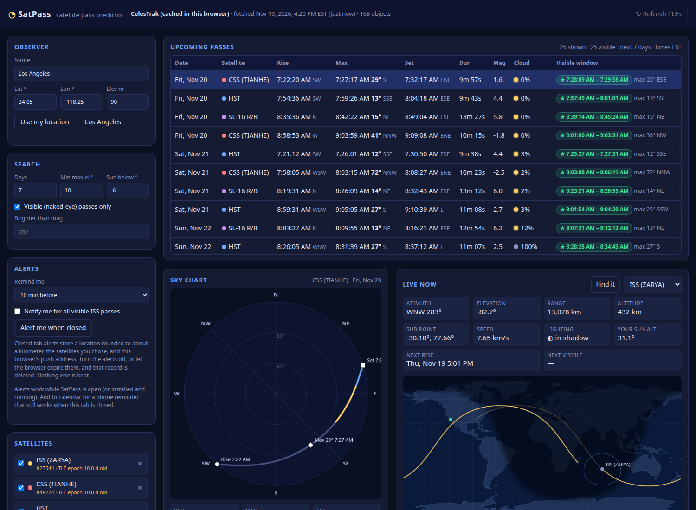

# SatPass

[SatPass](https://satpass.lukedw09.workers.dev/) is a satellite pass predictor. It shows when the ISS, Tiangong, Hubble, and other bright satellites cross your sky, and which of those passes you can see with the naked eye.

**Use it at [satpass.lukedw09.workers.dev](https://satpass.lukedw09.workers.dev/).**



It opens on downtown Los Angeles (34.05° N, 118.25° W, 90 m). Every clock time on the page is Eastern Time (EST or EDT), even if you move the observer somewhere else.

## Set your location

Under **Observer**, type a name, latitude, longitude, and elevation in meters. Or click **Use my location** and let the browser fill them in (it will ask permission). **Los Angeles** restores the default spot. This browser remembers your place, your filters, and your satellite list.

## Add and remove satellites

The list starts with the ISS, Tiangong, Hubble, Envisat, and two bright SL-16 rocket bodies. A tick includes that satellite in the search. Untick a row to skip it. **✕** removes it.

To add one, type a name or a NORAD catalog number — `HST` or `25544` — and press **Add**. Suggestions come from the space stations and the bright-satellite list. A NORAD number picks one object for sure. If a name matches several satellites, SatPass adds the first and tells you; enter the number to choose another.

## Filters

These sit under **Search**:

- **Days** — how far ahead to look, from 1 to 10. The default is 7.
- **Min max-el °** — hide passes that never get this high. `10` (the default) keeps passes that reach at least 10° above the horizon. `0` keeps anything that rises at all. `40` keeps only high ones.
- **Sun below °** — how far below the horizon the Sun must be before the sky counts as dark. The default is −6° (about civil twilight). The allowed range is −18° (a darker sky) to 0° (sunset level).
- **Visible (naked-eye) passes only** — on by default. Turn it off to list daylight and shadowed passes too. Each of those rows says why it fails: daylight, in shadow, or too low.
- **Brighter than mag** — leave it blank to keep every pass. Type a number such as `3` to keep only passes whose peak magnitude is brighter than that (a smaller number is brighter). A pass with no magnitude is left out while this filter is set.

The line above the table looks like `5 shown · 5 visible · next 7 days · times EST`. If a magnitude limit is set, it adds `brighter than 3`. If nothing is listed, lower the minimum elevation, add days, clear the magnitude box, or turn visible-only off.

## Reading a pass

Click a row. That pass is drawn on the sky chart, and **Live now** follows that satellite.

| Column | Meaning |
|---|---|
| Date | The day of the pass. **NOW** means it is above the horizon at this moment. |
| Satellite | Which object. The dot color matches the list on the left. |
| Rise | When it crosses your horizon, and the compass point to look toward (N, NE, WSW, and so on). |
| Max | The highest point: the time, the elevation in degrees, and the compass point. 0° is the horizon and 90° is straight overhead. A 20° pass is low; 60° is high in the sky. |
| Set | When it drops below the horizon again, and the compass point in that direction. |
| Dur | How long it stays above the horizon, such as `10m 13s`. |
| Mag | The brightest predicted magnitude during the visible stretch. Smaller numbers are brighter. `—` means SatPass has no standard magnitude for that object and will not guess. Click the heading to sort brightest first, click again for faintest first, and click **Date** to go back to time order. |
| Cloud | The forecast cloud cover for the hour nearest the highest point: a dot and a percent. Gold is clear (under 25%), half gold is partly cloudy (25–70%), and gray is cloudy (over 70%). Hover the cell for the low, mid, and high cloud. `no forecast` means that time is outside the 7-day forecast. If the forecast cannot be loaded, the column is left off the table. |
| Visible window | The stretch you can see, or the reason you cannot. |

A visible window looks like `★ 7:29:15 PM – 7:32:01 PM`, plus the best point of that stretch, such as `max 23° NW`. Rise, max, and set describe the whole pass from horizon to horizon. The starred times are the shorter part worth going outside for.

## Reminders

Every pass row, and the sky-chart detail under it, has a bell and an **Add to calendar** button. The bell asks for notification permission the first time you use it (or when you turn on the ISS option), then rings before the pass becomes visible. Choose **5, 10, or 15 minutes** under **Alerts**. **10** is the default. A gold bell means that pass is armed, and the card says how many alerts are set. **Notify me for all visible ISS passes** arms every visible ISS pass for you. The choice is remembered in this browser.

Those bells ring only while this tab is open. **Add to calendar** downloads an `.ics` file with the same lead time, so a phone calendar can remind you anyway. On an iPhone, Safari shows browser alerts only after you add SatPass to your Home Screen and open it from there.

## Install the app

**Install** appears in the header on Android Chrome once the browser offers to install SatPass. It uses the browser’s install prompt. On iPhone or iPad, the Alerts card says to tap Share, then Add to Home Screen, and to open SatPass from that icon. The installed app opens full screen, with a dark theme, and still launches if the network is down: the service worker keeps the page, the scripts, and the icons. Orbital data and the cloud forecast are not stored in that cache. The page keeps its own copies of those, and a failed refresh falls back to the copy already on the phone.

## Closed-tab alerts

**Alert me when closed** uses the same lead time, the ISS toggle, the bells you have armed, the visible-only filter, and the magnitude box. It asks for notification permission, then registers this browser with the SatPass Worker. A Cloudflare cron runs every 5 minutes. When a chosen pass starts within your lead time, the Worker sends one notice, for example `ISS in 10 min, rises NW 6:42 PM, max 54 deg, mag -3.1`. Tapping it opens SatPass on that pass. Changing the lead time, the place, the bells, or the filters updates the stored settings. **Stop closed-tab alerts** deletes them.

The Worker stores a location rounded to about a kilometer, the NORAD numbers you chose, the lead time, whether you want visible passes only, an optional magnitude limit, and the browser’s push address. It does not store a name. Turning alerts off deletes that record. A push service that says the browser is gone (HTTP 404 or 410) deletes it too.

**Send test push** shows once closed-tab alerts are on. It notifies this browser only, says that it is a test, and will not send again for about a minute.

Web Push on iPhone and iPad works only when SatPass is opened from the Home Screen, and only on iOS 16.4 or later. The Alerts card says so. Until then, use **Add to calendar**.

## Deploying the Worker

The site and the alert cron are one Worker, `satpass`, configured in `wrangler.jsonc`. Static files are the asset directory. `/api/*` is handled by `worker/index.js` first. Subscriptions live in a KV namespace bound as `ALERTS`. KV is one JSON document per browser, looked up by a hash of the push address, which is the whole access pattern: write the document, list a page on each cron tick, delete it. A database would not add a query this data needs.

Pull requests run `npx wrangler preview`. That publishes a preview of the branch, not the production Worker. The VAPID private key is never committed.

The production namespace is `satpass-ALERTS` (`dc9ec40f3ac94fa292a79b31597e5039`). It has been created, and its id is the top-level `kv_namespaces` entry. The `VAPID_PRIVATE_KEY` Worker secret has been set on the `satpass` Worker. The steps below are how that setup was done.

`wrangler preview` does not inherit the top-level bindings. It reads the `previews` block. That block points `ALERTS` at the namespace `satpass-alerts-preview` (`2a7da83f859d4dfba0a4fbfe8a152f32`), which is separate from production. Cron triggers stay on the production config.

1. Create the production KV namespace and put its id in the top-level `kv_namespaces` entry. Production is `satpass-ALERTS` (`dc9ec40f3ac94fa292a79b31597e5039`):

```bash
npx wrangler kv namespace create ALERTS
```

2. Generate a VAPID key pair. `@pushforge/builder` prints a public key and a private JWK. Keep the private JWK. Do not commit it and do not paste it into the dashboard as a plain variable.

```bash
npx @pushforge/builder vapid
```

3. Store the private JWK as a Worker secret. This command deploys a new version, so run it only when you mean to publish:

```bash
npx wrangler secret put VAPID_PRIVATE_KEY
```

Paste the private JWK JSON as the secret value. The public key is derived from that JWK at runtime. `VAPID_SUBJECT` is already set to `mailto:satpass@lukedw09.workers.dev` in `wrangler.jsonc`; change it if the contact address should be different.

Preview push uses the same key, applied to new previews rather than production:

```bash
npx wrangler preview base-config secret put VAPID_PRIVATE_KEY
```

4. Deploy. The cron `*/5 * * * *` is in `wrangler.jsonc`, so this deploy registers it:

```bash
npx wrangler deploy
```

Local development does not need a real key. A gitignored `.dev.vars` file with `SATPASS_DEV=1` makes `npx wrangler dev` mint a process-local key. That flag is not set in `wrangler.jsonc`, so production does not invent a key. `POST /api/push/test` is available in production too. It pushes only to the subscription that called it, and KV remembers the last attempt so a browser can send about one test a minute.

Each cron tick refreshes the station and bright-satellite element sets at most every 2 hours (cached in the same KV namespace). A catalog number that is not in that bundle, including a 6-digit NORAD id that legacy TLE cannot hold, is loaded as OMM JSON. A successful copy is not requested again for 2 hours, and the last good copy is kept for 3 days so a later timeout can still predict. A real not-found (HTTP 404) is cached for 2 hours. A timeout, network error, 429, or 5xx is not: later ticks retry with a backoff, and alerts keep using the last good elements or that cached group bundle. Requests send a SatPass User-Agent with the contact address. Alerts are due from the previous cron run up to now, and never more than 30 minutes back. The cron handles at most 20 subscribers per tick. A pass is sent once. The sent key is the NORAD number plus the start minute, and keys older than two days are dropped.

To run the checks: `node --test`. That covers magnitude, trains, clouds, pointing, subscription checks, the alert window, the push text, 6-digit OMM lookups, negative caching, a satellite error that must not block the rest, the test-push limit, and a skipped cron. MIT License © 2026 Luke de Wet. Orbits from [CelesTrak](https://celestrak.org/). Predictions use [satellite.js](https://github.com/shashwatak/satellite-js) (MIT). Web Push encryption uses [@pushforge/builder](https://github.com/pushforge/builder) (MIT). Cloud cover from [Open-Meteo](https://open-meteo.com/). Coastlines from [Natural Earth](https://www.naturalearthdata.com/).

## The sky chart

The chart looks straight up. The center is overhead, the rim is the horizon, and the rings mark 30° and 60°. North is at the top. Stand facing the rise direction from the table, then follow the arc.

The line uses the legend under the chart:

- **Gold — sunlit & dark sky (visible).** This is the part to watch.
- **Blue — sunlit, not visible.** The satellite is in sunlight, and your sky is still bright or it is below 10°.
- **Dim — in Earth's shadow.** Earth is between the Sun and the satellite, so it goes dark.

A circle is rise, a diamond is the highest point, and a square is set. During a pass that is happening now, a green dot marks where it is. Move the pointer along the arc and the chart shows the magnitude at that spot, or `—` when that object has no standard magnitude. Under the chart: duration, peak magnitude, distance at the highest point, and the Sun's altitude then. If the satellite enters shadow before it sets, the note says it fades into Earth's shadow.

## Find it

**Find it**, on a pass row or next to **Live now**, opens a full-screen pointer. Hold the phone so the rear camera faces the sky. A crosshair is where the phone is aimed. An arrow points toward the satellite, and the line under it says how far to turn and tilt, such as `Turn right 40° · tilt up 15°`. Within about 5° the crosshair turns green, the line says **On target**, and the phone vibrates once if it can.

The view also says whether the satellite is sunlit or in shadow, whether it is above the horizon, and its magnitude (or an em dash when SatPass has no standard brightness). If it is still below the horizon, the line says so and gives the next rise.

iPhone asks for motion access only after you tap **Enable compass**. A compass that needs calibrating asks you to wave the phone in a figure-8. A computer with no compass says so instead of pretending to point. **Camera** shows the rear camera behind the pointer. The picture stays on the phone: nothing is recorded or uploaded.

The compass heading is magnetic on iPhones. SatPass adds magnetic declination from a degree-6 truncation of the public World Magnetic Model 2025, so the arrow is in true azimuth. That correction is about a degree off the full model in ordinary latitudes, which is smaller than the wobble of a phone compass.

**Live now**, next to the chart, updates every second with direction, elevation, distance, height, speed, and whether the satellite is sunlit. The map draws its ground track from 45 minutes ago through 90 minutes ahead, the region where it is above the horizon, your location, and the night side of Earth.

## What "visible" means

A moment is visible only when all three are true:

1. **You are in the dark.** The Sun is below the **Sun below** number (default −6°).
2. **The satellite is sunlit**, clear of Earth's shadow.
3. **It is at least 10° up**, high enough to clear a lot of rooftops and trees.

That 10° floor stays put. **Min max-el** only decides which passes get a row. The visible window still opens at 10°.

## Spotting it

Be outside about a minute before the visible window opens, and look toward the rise compass direction, just above the horizon. You are looking for a steady, non-blinking moving dot that slides along the path on the chart. Keep following that arc. When the gold line ends and the track turns dim, the satellite is entering Earth's shadow and fades from sight.

The ISS is usually an obvious bright light. Hubble and the rocket bodies are much fainter, and a pass can meet the visible test and still be hard to see. The **Mag** column is there for that: it is an estimate, not a promise, and a tumbling rocket can be a magnitude or two off either way.

## Recent launches and Starlink trains

Under **Satellites**, **Recent launches** lists objects from CelesTrak's last-30-days group. Nothing in that list is included until you tick it.

A Starlink launch that is less than about 10 days old, and whose satellites are still close in mean motion, is one row: `Starlink train (Group 2026-242, launched Nov 14)`, with the number of satellites and how many minutes the string takes to pass. The prediction uses the lead satellite, the one at the front of the string. The group id is the international designator of the launch (year and launch number). When one of those trains has a visible pass in the search window, a gold banner above the table says when and which way to look, for example `Starlink train visible Tue 6:42 PM, look WNW`.

## Where the data comes from, and how fresh it is

Orbital data comes from [CelesTrak](https://celestrak.org/). The header says which copy the page is using:

- **CelesTrak live** — downloaded just now.
- **CelesTrak (cached in this browser)** — that same download, reused for about 2 hours.
- **Offline: bundled TLE snapshot** — a copy saved with the site, used when CelesTrak cannot be reached and this browser has nothing newer.

Next to the source is the fetch time and an age, such as `just now` or `3.2 h ago`. That age turns orange after 3 days. Each satellite also shows its own element-set age, such as `TLE epoch 0.6 d old`, and that label turns orange after 5 days. Older elements drift, so an orange age is a reason to refresh before you count on a time.

**↻ Refresh TLEs** downloads a new copy of the station list, the bright-satellite list, the last-30-days group, and the Starlink group. The button then waits 10 minutes, because CelesTrak asks people not to fetch too often. The same copy is kept in this browser for about 2 hours. Launch dates for the train list come from the CelesTrak catalog, on that same schedule.

Cloud cover comes from [Open-Meteo](https://open-meteo.com/) (no account). SatPass asks once when you change the observer, then reuses that forecast for about an hour. The request is the hourly total plus low, mid, and high cloud for 7 days in Eastern Time.

## How the predictions work

CelesTrak publishes a short description of each orbit, called an element set. SatPass runs those numbers through SGP4, the standard orbit model, in your browser with [satellite.js](https://github.com/shashwatak/satellite-js). SGP4 gives the satellite's position at the time in question. From your latitude and longitude, that becomes a compass direction and an elevation. The Sun's position does the rest: it decides whether your sky is dark, and whether Earth is casting its shadow across the satellite. The pass list, the sky chart, and the live map are that same calculation drawn three ways.

Magnitude, when SatPass has a standard brightness for that object, starts from the magnitude at 1000 km and a 90° phase angle. It then allows for distance, for how full the satellite looks (phase angle 0 means the Sun is behind you), and for about 0.2 magnitude of atmospheric extinction per airmass. The airmass is `1 / sin(elevation)`, and below 5° it stays at the 5° value so the number does not run away at the horizon. The standard values are the intrinsic magnitudes Heavens-Above publishes for the ISS, Tiangong's Tianhe module, Hubble, Envisat, and a few SL-16 rocket bodies. A new Starlink uses an approximate 5.0, which is the intrinsic magnitude Heavens-Above lists for a Starlink of that kind. Anything else stays blank.

## Accuracy and limits

A fresh element set is usually good to about a kilometer, which is close enough to find the pass by eye. The error grows as the set ages, which is what the age labels are for. The ISS reboosts its orbit, and a burn can move a pass by tens of seconds until CelesTrak publishes a new set.

"Visible" is still geometry: dark sky, sunlit satellite, at least 10° up. The magnitude is a separate estimate and can be off by about a magnitude when the satellite is tumbling or the sky is hazy. Terrain is ignored, so a hill or a building can hide a low pass. Atmospheric refraction is ignored too; it lifts an object on the horizon by about half a degree and shifts rise or set by a few seconds. Times are always Eastern, whatever time zone you are standing in.

To run a copy of the page by itself, open `index.html` in a browser. Find it and closed-tab alerts need HTTPS, which the hosted site already has. The Worker steps are under Deploying the Worker.
